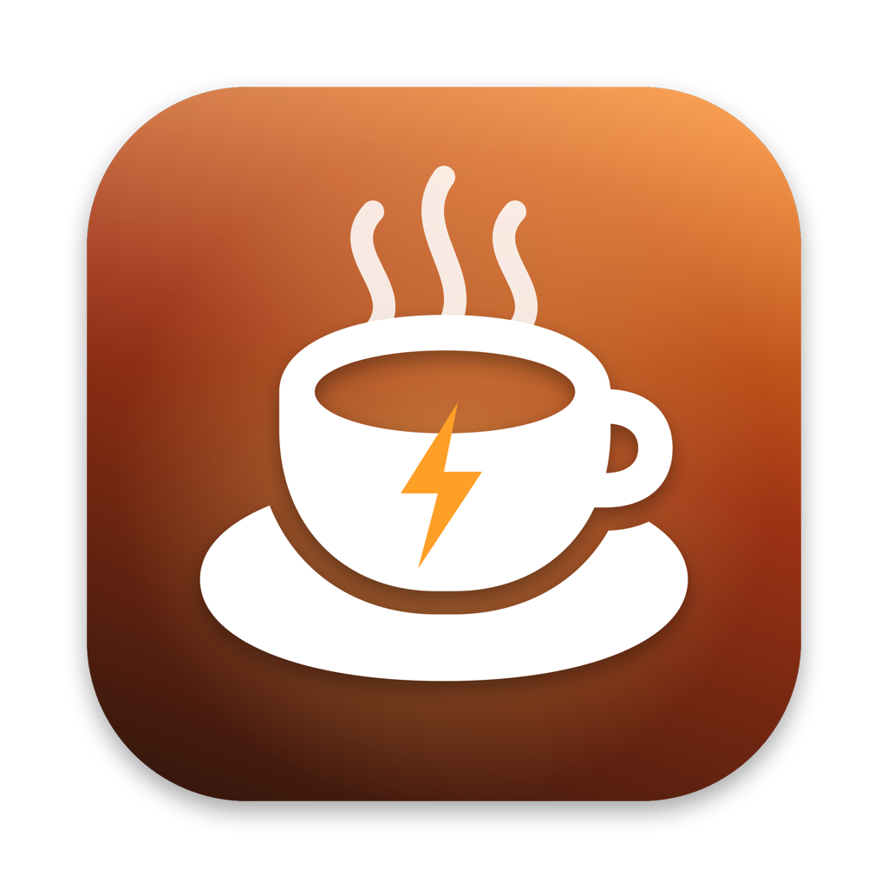

# Бодрячок



Приложение для меню-бара macOS, которое не даёт Mac уснуть: бессрочно, на заданное время, до нужного часа, пока открыта выбранная программа или с закрытой крышкой.

Сделано по мотивам [Amphetamine](https://apps.apple.com/app/amphetamine/id937984704). Весь код лежит в одном файле на Swift, зависимостей и Xcode-проекта нет.

> **English.** A tiny macOS menu bar app that keeps your Mac awake: indefinitely, for a set time, until a given hour, while another app is running, or with the lid closed. One Swift file, no dependencies. The interface is in Russian.

## Содержание

- [Возможности](#возможности)
- [Требования](#требования)
- [Установка](#установка)
- [Как пользоваться](#как-пользоваться)
- [Сессии](#сессии)
- [Режим закрытой крышки](#режим-закрытой-крышки)
- [Защита](#защита)
- [Настройки](#настройки)
- [Что приложение меняет в системе](#что-приложение-меняет-в-системе)
- [Удаление](#удаление)
- [Сборка](#сборка)
- [Ограничения](#ограничения)
- [Документация](#документация)

## Возможности

- **Не даёт Mac уснуть от бездействия.** Пока идёт сессия, не включаются ни сон, ни заставка, ни автоблокировка экрана.
- **Сессии на выбор:** бессрочно, на минуты или часы, до конкретного времени, пока работает выбранное приложение.
- **Режим закрытой крышки.** Mac продолжает работать, даже если закрыть крышку ноутбука.
- **Сон экрана отдельно.** Можно разрешить экрану гаснуть, а сам Mac оставить работать.
- **Защита.** Сессия сама завершается при низком заряде, режим крышки выключается при перегреве, экран блокируется при закрытии крышки.
- **Не оставляет Mac без сна.** Если приложение упадёт, системная настройка сна вернётся сама. Это страхуют три независимых механизма.
- **Объясняет, что произошло.** Если сессия закончилась сама, причина и время остаются в меню.

## Требования

- macOS 13 Ventura или новее.
- Mac с Apple Silicon или Intel.
- Для сборки нужны инструменты командной строки Xcode. Сам Xcode не нужен.

## Установка

### Готовый образ

1. Скачай [Bodryachok.dmg](https://github.com/iluvcashnhash/bodryachok/releases/latest/download/Bodryachok.dmg). Все версии лежат на странице [релизов](https://github.com/iluvcashnhash/bodryachok/releases).
2. Открой образ и перетащи «Бодрячок» в папку Applications («Программы»).
3. Запусти «Бодрячок» из «Программ». macOS заблокирует первый запуск: у приложения нет подписи разработчика Apple. Нажми «Готово».
4. Открой «Системные настройки → Конфиденциальность и безопасность», прокрути вниз до строки про «Бодрячок» и нажми «Всё равно открыть». На macOS 13 и 14 достаточно правого клика по приложению → «Открыть».
5. Справа в меню-баре появится чашка.

Та же инструкция лежит внутри образа в файле «Как установить.txt».

### Из исходников

Приложение собирается одной командой. Сборка занимает около минуты.

```bash
xcode-select --install   # если инструменты ещё не установлены
git clone https://github.com/iluvcashnhash/bodryachok.git
cd bodryachok
./build.sh --install
```

Скрипт соберёт `Бодрячок.app`, положит его в «Программы» и запустит. Справа в меню-баре появится чашка.

Приложение, собранное на своём Mac, запускается без предупреждений, шаги 3 и 4 из инструкции выше для него не нужны.

## Как пользоваться

| Действие | Что происходит |
|---|---|
| Левый клик по чашке | открывается меню |
| Правый клик или ⌃-клик | бессрочная сессия включается или выключается |
| Повторный запуск «Бодрячка» | меню открывается под курсором |

Последняя строка нужна на случай, когда чашку не видно. На Mac с вырезом камеры новые значки иногда оказываются под вырезом.

### Что показывает чашка

| Вид в меню-баре | Значение |
|---|---|
| пустая чашка | выключено, Mac может спать |
| закрашенная чашка и `∞` | идёт бессрочная сессия |
| закрашенная чашка и `1:23:45` | столько осталось до конца сессии |
| закрашенная чашка и `▸` | сессия идёт, пока открыто выбранное приложение |
| `⌄` после индикатора | режим закрытой крышки действует прямо сейчас |

Если значка `⌄` нет, с закрытой крышкой Mac уснёт, даже когда сессия идёт.

### Меню

```
Активно бессрочно                      статус
Крышку можно закрывать                 состояние режима крышки
Батарея: 80%
──────────────────────────────
Завершить сессию
──────────────────────────────
Заменить сессию                        заголовок; без сессии — «Новая сессия»
Бессрочно
Минуты                    ▸  5 · 10 · 15 · 30 · 45
Часы                      ▸  1 · 2 · 3 · 4 · 5 · 6 · 8 · 12 · 24
До времени…
Пока работает приложение  ▸  список открытых программ
──────────────────────────────
Не спать с закрытой крышкой
Разрешить сон экрана
──────────────────────────────
Настройки                 ▸
──────────────────────────────
Выйти
```

## Сессии

Сессия — это промежуток, в который Mac не засыпает. Одновременно идёт одна сессия. Новая заменяет текущую.

| Сессия | Когда заканчивается |
|---|---|
| Бессрочно | когда завершишь её сам |
| Минуты, Часы | когда выйдет время |
| До времени… | в выбранные час и минуту. Если это время сегодня уже прошло, сессия идёт до него же завтра |
| Пока работает приложение | когда выбранная программа закроется |

Любая сессия заканчивается раньше, если заряд упал ниже порога. Подробности в разделе [Защита](#защита).

Когда сессия завершается сама, приложение присылает уведомление, а в меню остаётся строка с причиной, например «Сессия завершена в 14:32: заряд ниже 20%». Строка исчезает при запуске следующей сессии.

## Режим закрытой крышки

Обычный запрет сна не действует на закрытую крышку: macOS усыпляет ноутбук принудительно. Пункт **«Не спать с закрытой крышкой»** отключает сон на уровне системы на время сессии.

Как это работает:

1. При первом включении приложение объясняет, что собирается сделать, и macOS один раз спрашивает пароль администратора.
2. Приложение получает право выполнять без пароля ровно одну системную команду: `pmset -a disablesleep 0` или `1`. Других прав у него нет.
3. Пока идёт сессия с этим режимом, сон отключён. Рядом с чашкой стоит значок `⌄`, а в меню написано «Крышку можно закрывать».
4. Когда сессия заканчивается, сон включается обратно.

Режим действует только во время сессии. Если поставить галочку, когда сессии нет, приложение само запустит бессрочную.

Право можно отозвать: «Настройки → Удалить доступ для режима крышки…».

> [!WARNING]
> Ноутбук с закрытой крышкой, который не спит, греется и тратит батарею. В сумке или рюкзаке теплу уходить некуда. Лёгкие задачи (загрузки, музыка, синхронизация) обычно переносятся нормально. Тяжёлые (рендер, сборка, экспорт) в закрытой сумке ноутбук перегреют.

## Защита

Все пункты включены сразу после установки.

| Что случилось | Что делает приложение |
|---|---|
| Заряд ниже порога при работе от батареи | завершает сессию, Mac снова может спать |
| macOS сообщает о серьёзном или критическом перегреве | выключает режим закрытой крышки до конца сессии. С закрытой крышкой Mac после этого уснёт |
| Крышку закрыли во время сессии с режимом крышки | сразу блокирует экран |
| Сессию запускают при заряде ниже порога | показывает окно с объяснением и кнопкой «Запустить всё равно» |
| Приложение завершилось или упало с отключённым сном | сон возвращается: сразу при обычном выходе, за несколько секунд при сбое, в течение минуты в худшем случае |
| Запущена вторая копия приложения | вторая копия сразу закрывается |

После отключения из-за перегрева работа сама не возобновится: спящий Mac нельзя разбудить изнутри. Она продолжится, когда откроешь крышку.

Если выбрать «Запустить всё равно», порог заряда не действует до конца этой сессии. Mac может разрядиться полностью.

## Настройки

Меню чашки → «Настройки».

| Настройка | По умолчанию | Что делает |
|---|---|---|
| Завершать при заряде ниже | 20% | Варианты: «Никогда», 10, 20, 30, 50%. Порог учитывается только при работе от батареи |
| Крышка — только от сети | выключено | Режим крышки работает только с подключённой зарядкой. От батареи Mac с закрытой крышкой засыпает |
| Блокировать экран при закрытии крышки | включено | Экран блокируется в момент закрытия крышки |
| Включать сессию при запуске | выключено | При старте приложения сразу начинается бессрочная сессия. Если заряд ниже порога, запуск пропускается |
| Запускать при входе в систему | выключено | Приложение стартует после входа в macOS |
| Удалить доступ для режима крышки… | — | Отзывает право управлять сном и убирает фонового страховщика. Пункт виден, только когда право выдано |

На Mac без крышки (iMac, Mac mini, Mac Studio) пункты про крышку скрыты.

## Что приложение меняет в системе

| Что | Где | Когда появляется |
|---|---|---|
| Настройки приложения | `~/Library/Preferences/local.bodryachok.plist` | при первом запуске |
| Правило sudo на одну команду | `/etc/sudoers.d/bodryachok` | при первом включении режима крышки |
| Фоновый страховщик | `~/Library/LaunchAgents/local.bodryachok.failsafe.plist` | там же |
| Скрипт страховщика | `~/Library/Application Support/Bodryachok/failsafe.sh` | там же |
| Системная настройка `SleepDisabled` | `pmset` | только на время сессии с режимом крышки |

Без режима крышки приложение не трогает ничего, кроме собственных настроек. В сеть оно не ходит и никаких данных не собирает.

## Удаление

1. Меню чашки → «Настройки» → «Удалить доступ для режима крышки…». Пункта нет, если режим крышки ни разу не включался.
2. Меню чашки → «Выйти».
3. Перетащи «Бодрячок» из «Программ» в Корзину.

Удалить настройки приложения:

```bash
defaults delete local.bodryachok
```

Если приложение уже удалено, а доступ для режима крышки остался, как убрать его вручную, написано в разделе [«Решение проблем»](docs/troubleshooting.md#как-убрать-всё-вручную).

## Сборка

Нужны только инструменты командной строки Xcode: `swiftc`, `lipo`, `sips`, `iconutil`, `codesign`, `hdiutil`.

| Команда | Что делает |
|---|---|
| `./build.sh` | собирает `Бодрячок.app` в папке проекта |
| `./build.sh --install` | собирает, ставит в «Программы» и перезапускает приложение |
| `./build.sh --dist` | собирает приложение и образ `Бодрячок.dmg` для передачи на другой Mac |

Сборка универсальная: Apple Silicon и Intel. Иконку рисует код в `make_icon.swift`, отдельного графического файла-исходника нет.

### Файлы проекта

| Файл | Назначение |
|---|---|
| `main.swift` | всё приложение |
| `make_icon.swift` | рисует иконку 1024×1024 |
| `build.sh` | сборка, установка, образ |
| `icon_1024.png` | готовая иконка, обновляется при сборке |
| `Как установить.txt` | инструкция для тех, кто получил готовый образ |
| `docs/` | техническая документация |

## Ограничения

- **Нет подписи разработчика Apple.** Скачанную сборку macOS блокирует при первом запуске, и её нужно разрешить вручную. Собранная локально запускается без предупреждений.
- **Мало проверок на разном железе.** Приложение проверялось на одном ноутбуке с Apple Silicon. Intel-версия запускалась только через Rosetta.
- **Отключение при перегреве не испытано настоящим перегревом.** Оно опирается на показатель температуры, который сообщает сама macOS.
- **Блокировка экрана при закрытии крышки использует непубличную системную функцию.** Если Apple её уберёт, сработает запасной путь: приложение выключит дисплей, а заблокируется ли экран, зависит от настроек экрана блокировки.
- **«Запускать при входе в систему» может сброситься после пересборки.** Тогда галочку нужно поставить заново.
- **«Пока работает приложение» следит за конкретным запущенным экземпляром.** Если программу перезапустить, сессия закончится.
- **Интерфейс только на русском.**

## Документация

- [Как это устроено](docs/architecture.md): запрет сна, режим крышки, права, страховка от сбоев, ключи настроек.
- [Решение проблем](docs/troubleshooting.md): что делать, если Mac всё равно засыпает, не видно чашку или сон не вернулся.
- [Как установить.txt](Как%20установить.txt): короткая инструкция для готового образа.

---

Проект не связан с авторами Amphetamine и с Apple.
